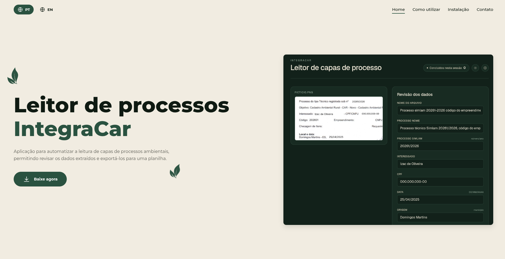

# Leitor de Processos (Site)

Página de apresentação do [**Leitor de Capas de Processos**](https://github.com/ElizaKOliveira/integracar-processos), aplicação que automatiza a leitura de capas de processos ambientais, permite revisar os dados extraídos e exportá-los para uma planilha.

## Recursos

- Página única com navegação por seções (Home, Como utilizar, Instalação e Contato)
- Idiomas em português e inglês
- Efeitos e animações suaves
- Guia detalhado de instalação e uso, com versões para Windows e Linux

## Tecnologias
- JavaScript
- React
- Vite
- HTML & CSS

## Deploy

O projeto é publicado na Vercel. A cada `git push` na branch `main`, uma nova versão é gerada automaticamente.
